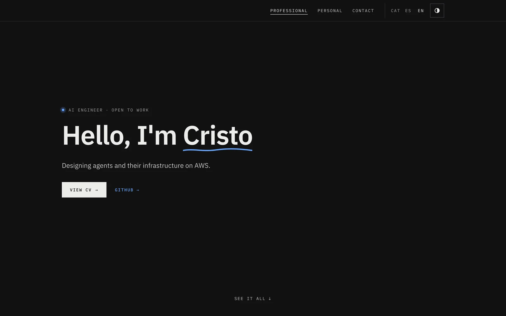

# Cristo — Portfolio

Personal portfolio of **Cristopher Gordon**, AI Engineer focused on designing agents and their infrastructure on AWS.

**→ [cristoge-portfolio.vercel.app](https://cristoge-portfolio.vercel.app)**



## Built with

- [Astro](https://astro.build) — fully static, no backend, no UI framework
- Native i18n in Catalan, Spanish and English, with typed dictionaries
- Light and dark themes
- Deployed on [Vercel](https://vercel.com)

## Project structure

```text
src/
├── pages/[...lang]/   # routes: index, personal, contact, projects/[slug]
├── layouts/           # BaseLayout: head, nav, footer
├── components/        # grouped by area: ui, layout, home, personal, contact
├── i18n/              # ca/es/en dictionaries, Dictionary type and helpers
├── data/              # language-independent data: site.ts and projects.ts
├── lib/               # non-UI utilities
└── styles/global.css  # design tokens
```

## Contact

[LinkedIn](https://www.linkedin.com/in/cristopher-gordon/)
